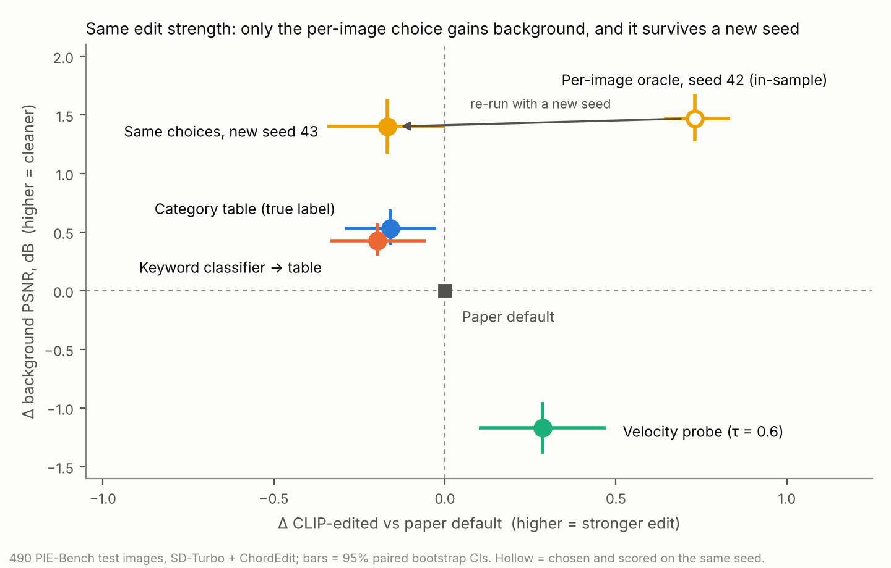

# Choosing the noise level from the prompt: adaptive timesteps for one-step image editing

This project tests the next step proposed by
[*Rethinking One-Step Image Editing through ChordEdit*](https://arxiv.org/abs/2606.14042) (Li, Moebel & Wang, 2026):
**prompt-conditioned timestep selection**. That study showed two things:

- ChordEdit's chord window acts mostly as a timestep shift.
- High-noise transport makes coarse, low-frequency changes, while low-noise alignment adds fine detail.

If that is right, the best timestep should depend on the edit, so a single fixed setting leaves quality behind.

This repo measures how much quality the fixed setting leaves behind, and how much of it three cheap predictors recover:

| Predictor | Sees | Extra cost |
| --- | --- | --- |
| Category table (oracle label) | PIE-Bench's true edit type | none (upper bound for classifiers) |
| Prompt keywords → category table | source + target prompt | none |
| Small LLM → category table | source + target prompt | one 1.5B-LLM call |
| **Velocity probe** (training-free) | the image + both prompts | one batched UNet pass |

The velocity probe measures where the target- and source-prompt predictions start to disagree as noise increases. It then picks the smallest timestep at which the edit becomes possible; see `report/report.md`, Section 3.

**Every edit runs through the lab's own pipeline** (`ext/ChordEdit-Reproduction`), and every metric through the lab's own PIE-Bench evaluator (`ext/PnPInversion`). This project only decides *which timesteps* to run with. Everything is tuned on a stratified **dev** split (30%) and reported on the held-out **test** split, with paired bootstrap confidence intervals.

## Results of the first full run (Nov 21–22, 2026)

700 PIE-Bench images × 29 settings, seed 42, one RTX 4090 (0.5 s per edit, about 3.5 GPU-hours). The full write-up is in `report/report.md`.

1. **The reproduction matches.** At the paper default, CLIP-edited is 22.30 and background PSNR 22.76 dB. The lab's reproduction reports 22.16 and about 22.6.
2. **The combined score J can be gamed.** It is maximized by the gentlest setting (t_start 0.5, t_end 0.1), which simply edits less (CLIP-edited 20.76). So the auto-filled "gap closed %" in `main_table.md` is **not** evidence. `scripts/08_constrained_analysis.py` compares methods at matched edit strength instead.
3. **At matched strength, prompt-level rules only trade.**
   - Category tables: −0.16 CLIP-edited for +0.53 dB background PSNR.
   - Velocity probe: +0.28 CLIP-edited for −1.17 dB.
4. **The per-image choice is real for the background.** `scripts/09_heldout_seed.py` re-runs the oracle's seed-42 choices with seed 43:
   - The background gain holds: +1.47 → +1.40 dB [CI +1.17, +1.64].
   - The edit-strength gain was seed noise: +0.73 → −0.17.



## Cost and time (RTX 4090 24 GB)

| Stage | Work | Time (1 seed) | Time (3 seeds) |
| --- | --- | --- | --- |
| Grid of edits | 29 configs × 700 images | ≈ 3 h | ≈ 8–9 h |
| PIE-Bench metrics | same images | ≈ 2–3 h | ≈ 6–8 h |
| Velocity probe | 700 images × 28 batched UNet evals | ≈ 15 min | (1 seed only) |
| LLM classifier | 700 prompt pairs | ≈ 5 min | ≈ 5 min |
| **Total** | | **≈ 5–6 h, ≈ $2–4** | **≈ 15–18 h, ≈ $6–12** |

Measured on the first run: 0.50 s per edit per worker with 2 workers on one RTX 4090, and 0.70 s per image for the probe. The whole 1-seed study took about 3.5 GPU-hours. **Terminate the pod as soon as the run ends: an idle pod bills by the hour.** The held-out-seed check (script 09) adds about 15 minutes. Prices are RunPod on-demand rates (RTX 4090 from about $0.34/h). Allow 30 GB of disk; the edited images are about 3 GB per seed.

## Steps

**0. Today: request PIE-Bench.** Fill in the form linked in the [PnPInversion README](https://github.com/cure-lab/PnPInversion#benchmark-download). You will get a download link for `PIE-Bench_v1`.

**1. Rent a GPU.** On RunPod, choose an RTX 4090 pod (or an L40S 48 GB) with the PyTorch 2.x template and a 30 GB+ volume. Then:

```bash
git clone <this repo> adaptive-timestep-edit && cd adaptive-timestep-edit
bash setup_runpod.sh                 # clones the lab repos, installs deps, downloads SD-Turbo
# unzip PIE-Bench so these exist:
#   datasets/PIE-Bench_v1/annotation_images/   datasets/PIE-Bench_v1/mapping_file.json
```

**2. Check the setup on 70 images (about 10 minutes), then run the study:**

```bash
bash run_all.sh --max-samples 70     # sanity check: look at work/grid/*/seed42/ and work/results/
rm -rf work                          # discard the sanity run
bash run_all.sh --quick              # 1 seed, ~5-6 h. Safe to stop and re-run: every stage resumes.
bash run_all.sh                      # adds seeds 43 and 44 for the final numbers (~10 h more)
```

Run it inside `tmux` so it survives a dropped connection. If the pod restarts, re-run the same command and finished work is skipped.

**3. Read the results** in `work/results/`:

- `main_table.md`: every method on the test split. It shows the edit score J, its gain over the paper default with a 95% CI, the share of the oracle gap closed, CLIP-edited, background PSNR/LPIPS, structure distance, and extra UNet calls.
- `summary.json`: the headline numbers. Run `python scripts/07_fill_report.py` to put them into the report and email drafts.
- `fig_heatmap.png`: which timestep each edit category prefers.
- `fig_gap_closed.png`: the main result.
- `fig_probe_curves.png`: the probe signal, by category.
- `sensitivity.csv`: whether the conclusion holds when the score weights preservation 0.5× / 1× / 2×.
- `probe_tuning.csv`, `classifier.csv`, `timing_grid.csv`: details.

**4. Run the two checks that matter** (CPU for 08; about 15 GPU-minutes for 09):

```bash
python scripts/08_constrained_analysis.py            # matched edit strength -> constrained_results.json
python scripts/09_heldout_seed.py --shard 0/2 &      # re-run the oracle's choices with a new seed
python scripts/09_heldout_seed.py --shard 1/2; wait
python scripts/09_heldout_seed.py --report           # -> heldout_seed.json
```

**Smoke test without a GPU** (about 30 s, no downloads; checks that the code runs, not the results): `bash run_all.sh --fake`, then `pytest -q`.

## How "best" is defined

A single score, **J = edit term + preservation term**, ranks configurations. Every metric is z-scored on the dev split.

- **Edit term:** CLIP similarity of the whole edited image, and of the edited region, to the target prompt.
- **Preservation term:** background PSNR, −background LPIPS, and −structure distance.

Every table also reports the raw PIE-Bench metrics, so no conclusion depends only on J. `sensitivity.csv` re-runs the comparison with the preservation term weighted 0.5×, 1× and 2×.

**Two oracles bound what any predictor could achieve:**

- **In-sample per-image oracle:** the best config for each image. It is optimistic, because picking the maximum of 29 noisy scores favors lucky draws.
- **Held-out-seed oracle:** the config is picked on seed 42 and scored on seeds 43–44. This is the honest upper bound.

## Honest caveats

- **Prompt brackets.** The lab's `run_pie_bench.py` feeds PIE prompts *with* their `[ ]` blend markers, and so does this repo by default, to match the lab. Set `grid.strip_brackets: true` to run the clean-prompt variant as a check.
- **Narrow setup.** It is one model (SD-Turbo), one benchmark (PIE-Bench) and automatic metrics only.
- **A negative result still counts.** On the first run, J was gamed by editing less, and prompt-level rules did not beat the default at matched strength (see Results above).
- **The LLM classifier collapsed.** Qwen2.5-1.5B labels 69% of prompts "change content" (13% accuracy). Use a larger model or constrained decoding before trusting its rows.
- **Whole-image masks.** Background metrics are undefined when the edit mask covers the whole frame (mostly "change style"); those images drop out of the background numbers.

## Layout

```
ate/            library: config grid, PIE loading/splits, lab-pipeline wrapper + probe, objective, analysis, plots
scripts/01..09  numbered, resumable stages (run_all.sh runs 01-06; 08 = matched-strength analysis, 09 = held-out-seed check)
configs/        default.yaml (grid, seeds, split, objective weights, probe settings)
tests/          unit tests (mask decoding matches the lab evaluator, probe equals ChordEdit's update, oracles, ...)
report/         report.md (the note, with results) + fig_tradeoff.png + email_template.txt
results/        image_features.csv (per-image edit-mask area and prompt-change counts, for the next-step analysis)
```

## Credits

The editing code is the lab's [ChordEdit reproduction](https://github.com/Harvard-AI-and-Robotics-Lab/ChordEdit-Reproduction) of
[ChordEdit (Lu et al., CVPR 2026)](https://arxiv.org/abs/2602.19083). The evaluation is the lab's fork of
[PnPInversion / PIE-Bench](https://github.com/Harvard-AI-and-Robotics-Lab/PnPInversion). Please cite those works.
