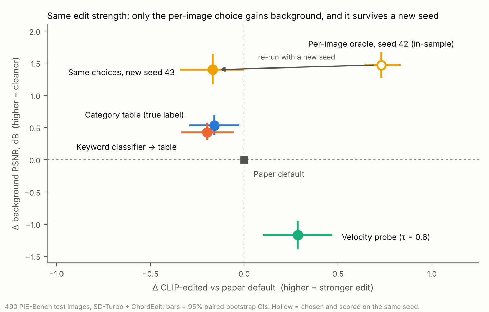

<!-- Results from the first full run (Nov 21–22, 2026): 700 images x 29 settings, seed 42, plus a held-out
seed-43 check of the per-image oracle. Numbers come from work/results/{main_table.csv, sensitivity.csv,
constrained_results.json, heldout_seed.json}. Convert with: pandoc report.md -o report.pdf -->

## Abstract

A recent reproduction of ChordEdit, a one-step image editor, proposed choosing the editing timestep from the prompt [Li et al. 2026]. We test that proposal on all 700 PIE-Bench images with SD-Turbo, using the lab's pipeline and evaluator.

- **Sweep.** We sweep 29 (t_start, t_end) settings and reproduce the paper default (CLIP-edited 22.30 vs. 22.16 in the lab's reproduction).
- **Predictors.** We compare per-category tables, prompt classifiers and a training-free velocity probe, all tuned on a dev split and scored on 490 test images.

We report three findings:

1. A naive edit-plus-preservation score can be gamed by editing less, so we compare methods at matched edit strength.
2. At matched strength, no prompt-level rule beats the paper default. Category tables and the probe only move along the edit/background trade-off.
3. The per-image best setting does help. It improves background PSNR by +1.40 dB [95% CI +1.17, +1.64] at equal edit strength, and this gain **survives a fresh random seed**. Its apparent edit-strength gain does not.

The useful signal for timestep choice therefore seems to be a property of the image, not of the prompt type.

## 1. Introduction

Choosing the noise level is the oldest trade-off in diffusion editing. In SDEdit [Meng et al. 2022], more noise buys editability at the cost of faithfulness to the source. One-step editors make the choice starker, because there is no trajectory to spread the change over.

ChordEdit [Lu et al. 2026] performs a single "chord" transport step at t_start and a proximal clean-up at t_end. Its reproduction study [Li et al. 2026] made three findings:

- the chord window δ acts largely as a shift from t to t − δ;
- δ = 0 with t_start ≈ 0.75 roughly matches the default;
- transport at high noise makes low-frequency semantic changes, while low noise adds high-frequency detail.

The study proposed *prompt-conditioned dynamic timestep selection* as future work. We ask:

1. How much does the best timestep vary across images?
2. Can that variation be predicted cheaply from the prompt, or from the model's own response to it?
3. Which part of any apparent gain is real, and which is selection noise?

Our contributions:

- A full (t_start, t_end) sweep on PIE-Bench with a dev/test split and paired bootstrap CIs.
- A **matched-strength** comparison that removes the "edit less" loophole of combined scores.
- A **held-out-seed** test of the per-image oracle, which separates real per-image headroom from winner's-curse noise.
- All code, per-image metrics and analysis scripts.

## 2. Related work

**Noise level in editing.** SDEdit [Meng et al. 2022] exposes the noise strength as a user knob. DDS [Hertz et al. 2023] and FlowEdit [Kulikov et al. 2024] integrate the *difference* between target- and source-conditioned predictions. Delta Rectified Flow Sampling [Beaudouin et al. 2026] unifies the two with a time-dependent shift.

**One-step editing.** ChordEdit [Lu et al. 2026] builds on adversarially distilled models such as SD-Turbo [Sauer et al. 2023]. The reproduction study [Li et al. 2026] is our starting point.

**Prompt-aware editing.** SplitFlow [Yoon et al. 2025] uses an LLM to split prompts into sub-edits. Our LLM classifier borrows the idea to choose timesteps instead.

**Evaluation.** We use PIE-Bench [Ju et al. 2024] with the evaluator used by the ChordEdit reproduction.

## 3. Method

**Setup.** Let x be the source latent, c_s and c_t the source and target prompts, z_t = α_t x + σ_t ε, and x̂₀(z_t, c) = (z_t − σ_t ε̂(z_t, t, c)) / α_t the model's clean-image prediction. With δ = 0, ChordEdit's transport update is

```latex
u(t) = \mathbb{E}_{\epsilon}\left[\hat{x}_0(z_t, c_t) - \hat{x}_0(z_t, c_s)\right], \qquad x' = x + u(t_{\text{start}})
```

The clean-up step returns x̂₀(α_{t_end} x′ + σ_{t_end} ε, c_t).

**The hypothesis behind a probe.** By Tweedie's formula, x̂₀(z_t, c) approximates E[x₀ | z_t, c], so d(t) = x̂₀(z_t, c_t) − x̂₀(z_t, c_s) is a difference of two posterior means. Two cases follow:

- **Small σ_t.** Both posteriors collapse onto x, so d(t) → 0: the edit is not yet reachable.
- **Growing σ_t.** Noise hides frequency bands from fine to coarse, because natural-image power falls roughly as 1/f². So an edit should become reachable once the band it must change is hidden. That suggests low t for texture edits and high t for color, layout and style.

**Velocity probe.** The probe measures s̄(t) = RMS(E_k d_k(t)) at 7 candidate timesteps, with 2 noise draws and both prompts. That is 28 UNet evaluations, batched, taking 0.70 s per image (an edit takes 0.50 s). Two rules turn the curve into a timestep, with τ and t_end chosen on dev:

- **Knee rule:** pick the smallest t with s̄(t) ≥ τ · max s̄.
- **Consistency rule:** maximize s(t)·ρ(t), where ρ is the agreement of d across noise draws.

**Category baselines.** A table maps each PIE category to its dev-best setting. It is applied in three ways:

- with the true label, an upper bound for any prompt classifier;
- with a keyword rule over the prompt word-diff;
- with Qwen2.5-1.5B-Instruct used few-shot.

**Two ways to score.**

1. **Combined score J.** J adds an edit term to a preservation term, each built from metrics z-scored on dev:
   - edit term: CLIP of the whole image and of the edited region;
   - preservation term: background PSNR, −LPIPS and −structure distance.
2. **Matched strength.** Because J can rise by editing less (Section 5.2), we also compare methods under constraints:
   - **(A) Same edit strength:** a setting is eligible only if both CLIP scores are at least the default's on dev. Among those, choose the cleanest background.
   - **(B) Same background:** a setting is eligible only if background PSNR ≥ and LPIPS ≤ the default's. Among those, choose the strongest edit.

**Held-out seed.** For each test image, the per-image oracle picks the best setting from its seed-42 scores. That is optimistic: with 29 noisy candidates, the maximum is biased upward. We therefore re-ran the oracle's choices and the default with seed 43 (1,075 new edits) and measured the paired difference again.

## 4. Experimental setup

**Model and data.**

- **Model:** SD-Turbo through the lab's ChordEdit reproduction pipeline (fp32, 512², one noise sample, clean-up on).
- **Data:** PIE-Bench, 700 images in 10 edit categories. Prompts are passed with their bracket markers, as in the lab's script.

**Grid.**

- t_start ∈ {0.5, 0.6, 0.7, 0.75, 0.8, 0.9, 1.0} and t_end ∈ {0.1, 0.2, 0.3, 0.4}, with δ = 0.
- Two more settings: the paper default (0.9, 0.3, δ = 0.15) and the simplified setting (0.75, 0.3, 0).
- 29 settings × 700 images = 20,300 edits with seed 42. This took about 3.5 hours on one RTX 4090.

**Metrics.** All metrics come from the lab's PIE-Bench evaluator:

- structure distance (DINO);
- background PSNR, LPIPS and SSIM;
- CLIP similarity of the whole image and of the edited region.

Images whose edit mask covers the whole frame (mostly "change style") have no background, so they drop out of the background averages.

**Protocol.**

- **Split:** stratified by category, 210 dev and 490 test images. Every choice is fit on dev.
- **Uncertainty:** 95% CIs from a paired bootstrap over test images (2,000 resamples).

## 5. Results

### 5.1 The reproduction matches

At the paper default, CLIP-edited is 22.30, background PSNR 22.76 dB and LPIPS 0.116. The lab's reproduction reports 22.16 CLIP-edited and about 22.6 dB; the original paper reports 22.96.

### 5.2 A combined score rewards editing less

Under J with equal weights, the best single setting on dev is the gentlest one in the grid, (t_start 0.5, t_end 0.1).

- **Its score:** ΔJ = +0.46 [+0.40, +0.52] over the default.
- **What it does:** background PSNR rises to 27.73 dB and LPIPS falls to 0.055, but CLIP-edited drops to 20.76.
- **Category tables add nothing:** every category picks the same setting, so the tables reduce to it.

That is a weaker edit, not a better one, and it sits on the edge of the grid. With the preservation weight halved, nothing beats the default: the best fixed setting gives ΔJ = +0.03 [−0.02, +0.07] and the probe −0.02 [−0.06, +0.02]. We therefore do not read J-based "gap closed" numbers as evidence.

### 5.3 At matched strength, prompt-level rules only trade

**Table 1.** Constraint (A), same edit strength. Change vs. the paper default on 490 test images.

| Method | Δ CLIP-edited | Δ BG PSNR (dB) | Δ BG LPIPS |
| --- | --- | --- | --- |
| Best single setting (dev) | 0 (= default) | 0 | 0 |
| Category table, true label | −0.16 [−0.29, −0.03] | +0.53 [+0.39, +0.70] | −0.007 |
| Keyword classifier → table | −0.20 [−0.34, −0.06] | +0.43 [+0.30, +0.58] | −0.005 |
| Velocity probe (knee, τ = 0.6) | +0.28 [+0.10, +0.47] | −1.17 [−1.39, −0.95] | +0.013 |
| Per-image oracle (seed 42, in-sample) | +0.73 [+0.64, +0.83] | +1.47 [+1.27, +1.68] | −0.021 |

Three points stand out:

- **The default is already the best fixed setting at its own edit strength.** No other fixed setting matches its CLIP scores with a cleaner background.
- **The category tables lose edit strength on test.** They meet the constraint on dev but not on test, because each is fit on about 21 dev images.
- **The probe moves the other way.** It buys edit strength with background quality.

Constraint (B) tells the same story. The category table gives −0.10 [−0.19, −0.02] CLIP-edited for +0.48 dB. The best fixed setting, (0.7, 0.3), gives −0.20 [−0.38, −0.02] for +0.26 dB.

### 5.4 The held-out seed separates signal from noise

**Table 2.** Per-image oracle: chosen on seed 42, then re-run on seed 43. Change vs. the default at the same seed.

| Oracle | Metric | Seed 42 (in-sample) | Seed 43 (held out) |
| --- | --- | --- | --- |
| (A) same edit strength | Δ CLIP-edited | +0.73 [+0.64, +0.83] | −0.17 [−0.34, +0.00] |
| | Δ BG PSNR (dB) | +1.47 [+1.27, +1.68] | +1.40 [+1.17, +1.64] |
| | Δ BG LPIPS | −0.021 | −0.022 [−0.025, −0.018] |
| (B) same background | Δ CLIP-edited | +1.16 [+1.02, +1.30] | +0.04 [−0.12, +0.20] |
| | Δ BG PSNR (dB) | +1.28 [+1.13, +1.43] | +1.14 [+0.95, +1.35] |

**The edit-strength gains vanish on the new seed.** They came from picking the luckiest of 29 noisy edits.

**The background gains hardly move.** They hold at +1.1 to +1.4 dB PSNR, with LPIPS and structure distance improving as well, all with CIs away from zero.

So for a given image, some settings reliably protect its background better than the default does, at no measurable cost in edit strength. That property belongs to the image, not to the seed.

### 5.5 Why the prompt-level predictors miss it

- **Category curves nearly coincide.** The normalized probe curves of the 10 categories almost overlap (Figure 1). The mean knee timestep ranges only from 0.68 (change object) to 0.78 (change color).
- **The probe measures the wrong thing.** It measures where the two prompts' predictions diverge, which is reachability of the edit. Reachability tracks edit strength, not risk to the background, so tuning the probe pushes toward stronger edits (Table 1).
- **The classifiers are weak.**
  - The keyword rule is 48% accurate.
  - The 1.5B LLM collapsed: it assigns 69% of prompts to "change content" (13% accuracy, near chance). Its rows are omitted; it needs a larger model or constrained decoding.
- **Category labels would not help anyway.** Even with the true label, the per-category tables do not transfer from dev to test.




## 6. Discussion

The coarse/fine picture of Section 3 predicts *when an edit becomes reachable*. That is a property of the edit type, and the probe does recover it. But the reachable range turns out to be broad for every category. Across that range, what varies between images is how much of the *unedited* region the model repaints, and that is what the per-image oracle exploits.

This points to a different predictor. Instead of asking "which kind of edit is this?", it should ask "how fragile is this image's background at this noise level?" Candidate inputs:

- the edit-mask area;
- texture and contrast statistics of the unedited region;
- the source-prompt reconstruction error x̂₀(z_t, c_s) − x at each t, which the probe already computes for free.

## 7. Limitations and next steps

**Limitations.**

- **Seeds:** one seed for the grid, plus one held-out seed for the oracle.
- **Metrics:** automatic only. CLIP-based scores can reward prompt keywords over faithful edits; a small human or VLM study would strengthen the claims.
- **Grid:** it stops at t_start = 0.5, and the combined score's optimum lies on that edge.
- **Oracle:** it needs all 29 edits of an image. It is an upper bound, not a method.

**Next steps.**

1. **Predict background fragility.** Learn per-image "gentle vs. default" choices from cheap image-level signals (above), trained on dev and evaluated on test with a fresh seed.
2. **Strengthen the sweep.** Extend the grid below 0.5 and add two seeds.
3. **Video.** Apply the same per-image analysis to rectified-flow video editing (Wan-Edit on FiVE-Bench [Li et al. 2025]), where one shift schedule is currently used for all edits.

## References

- Beaudouin, G., Li, M., Kim, J., Yoon, S.-H., Wang, M. Delta Rectified Flow Sampling for Text-to-Image Editing. CVPR 2026. arXiv:2509.05342
- Hertz, A., Aberman, K., Cohen-Or, D. Delta Denoising Score. ICCV 2023. arXiv:2304.07090
- Ju, X., Zeng, A., Bian, Y., Liu, S., Xu, Q. PnP Inversion: Boosting Diffusion-based Editing with 3 Lines of Code (PIE-Bench). ICLR 2024. arXiv:2310.01506
- Kulikov, V., Kleiner, M., Huberman-Spiegelglas, I., Michaeli, T. FlowEdit: Inversion-Free Text-Based Editing Using Pre-Trained Flow Models. arXiv:2412.08629
- Li, M., Moebel, J., Wang, M. Rethinking One-Step Image Editing through ChordEdit: Reproduction, Simplification, and New Insights. arXiv:2606.14042, 2026
- Li, M., Xie, C., Wu, Y., Zhang, L., Wang, M. FiVE: A Fine-grained Video Editing Benchmark for Evaluating Emerging Diffusion and Rectified Flow Models. ICCV 2025. arXiv:2503.13684
- Lu, L., Chen, X., Guo, M., Li, S., Wang, J., Shi, Y. ChordEdit: One-Step Low-Energy Transport for Image Editing. CVPR 2026. arXiv:2602.19083
- Meng, C., He, Y., Song, Y., Song, J., Wu, J., Zhu, J.-Y., Ermon, S. SDEdit: Guided Image Synthesis and Editing with SDEs. ICLR 2022. arXiv:2108.01073
- Sauer, A., Lorenz, D., Blattmann, A., Rombach, R. Adversarial Diffusion Distillation. arXiv:2311.17042
- Yoon, S.-H., Li, M., Beaudouin, G., Wen, C., Azhar, M. R., Wang, M. SplitFlow: Flow Decomposition for Inversion-Free Text-to-Image Editing. NeurIPS 2025. arXiv:2510.25970
